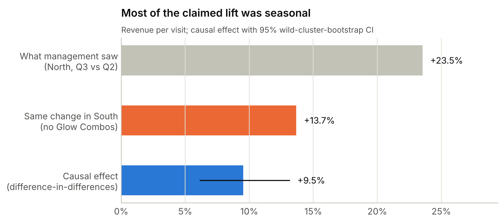

# Salon Experiment & Causal Analysis

Design an A/B test and measure the true impact of a business change, for **Bloom & Blade Salon & Spa**, a
fictional 22-outlet salon and spa chain in Coimbatore.

* **Part A, test design:** an A/B test for *Smart Reminders* (WhatsApp reminders with one-tap reschedule):
  hypothesis, metrics, guardrails, power analysis and duration.
* **Part B, test analysis:** SRM, balance, effects with confidence intervals (delta method, bootstrap,
  Welch t-test), segments, and CUPED / regression adjustment.
* **Part C, causal analysis:** did last quarter's *Glow Combos* menu really lift results, or was it the
  season? Answered with difference-in-differences against a tested control zone.

## Key results

| Question | Answer |
|---|---|
| Do WhatsApp reminders reduce no-shows? | **Yes. GO.** No-show rate 12.4% → 9.8%: -2.5 pp (95% CI -4.0 pp to -1.1 pp), p = 0.0006 |
| Any harm? | No chain-level guardrail breached. Clients aged **55+** opt out at 5.1% and get no benefit, so give them a call/SMS instead |
| Was the test valid? | Chain-wide SRM passed, but BB16 failed (integration live late) and was excluded. Balance max SMD 0.075 |
| How much shorter with CUPED? | Regression adjustment cut variance 5.9%: 21.3 → 20.1 enrolment days, i.e. **3 weeks instead of 4** |
| Did Glow Combos work? | Revenue per visit **+9.5%** (CI +6.1% to +13.2%), not the claimed +23.5%. Visits -7.1% (men's grooming -11%). Total revenue +1.8%, not significant. **EXTEND** |
| Is the DiD credible? | South passes every pre-trend test, Central fails. Flat event study; placebo tests show no effect; randomisation inference p = 0.0003 |



## Deliverables

| Deliverable | File |
|---|---|
| Experiment design document | [`docs/01_experiment_design.md`](docs/01_experiment_design.md) |
| Analysis notebook (Python, executed) | [`notebooks/salon_experiment_analysis.ipynb`](notebooks/salon_experiment_analysis.ipynb) |
| One-page decision memo | [`docs/02_decision_memo.md`](docs/02_decision_memo.md) |
| What could make the estimates wrong | [`docs/03_what_could_make_the_estimates_wrong.md`](docs/03_what_could_make_the_estimates_wrong.md) |
| Viva preparation (Q&A) | [`docs/04_viva_prep.md`](docs/04_viva_prep.md) |
| One-page decision memo (Word) | [`docs/Decision_Memo.docx`](docs/Decision_Memo.docx) |
| Full project report (Word) | [`reports/Salon_Experiment_Causal_Analysis_Report.docx`](reports/Salon_Experiment_Causal_Analysis_Report.docx) |
| Data dictionary | [`data/README.md`](data/README.md) |

## Repository layout

```
├── data/
│   ├── raw/                 7 synthetic till exports (~304k appointments, 22 outlets)
│   ├── reference/           service alias table (outlet spellings -> canonical service)
│   ├── processed/           cleaned tables, rebuilt when the notebook runs
│   └── README.md            data dictionary
├── src/
│   ├── generate_data.py     seeded simulator for the whole chain (incl. the planted data problems)
│   ├── cleaning.py          8 data-quality fixes, each logged
│   ├── power_analysis.py    sample size, design effect, A/A simulation
│   ├── ab_testing.py        SRM, balance, delta method, bootstrap, CACE, segments
│   ├── variance_reduction.py  CUPED and regression adjustment
│   ├── did.py               TWFE DiD, wild cluster bootstrap, event study, placebos, randomisation inference
│   └── viz.py               chart style and figures
├── notebooks/salon_experiment_analysis.ipynb
├── docs/                    design doc, decision memo, threats to validity, viva prep
├── reports/                 figures, tables, results.json, Word report
└── requirements.txt
```

## How to run

```bash
pip install -r requirements.txt
python src/generate_data.py         # optional: rebuilds data/raw exactly (seed 404)
jupyter notebook notebooks/salon_experiment_analysis.ipynb   # Run All (~1 minute)
```

The notebook cleans the data, runs every analysis, saves the figures to `reports/figures/`, and writes all
reported numbers to `reports/results.json`.

## Data cleaning in one table

| Problem (from the brief, plus what profiling found) | Fix |
|---|---|
| **No-shows logged as cancellations** (recorded 2.3%, true 12.4%) | Rebuilt from cancellation timestamps and remarks; validated against SalonCloud outlets and the reminder platform |
| **Service names differ by outlet** (2,195 spellings of 38 services) | Alias table, fuzzy matching and a price sanity check; 100% mapped |
| **Walk-ins without client IDs** (93% of walk-ins) | Kept for outlet metrics; excluded from client-level metrics and from the A/B test |
| Duplicate rows, two date formats, amounts as text, inconsistent labels | De-duplicated; formats parsed explicitly; labels standardised |

## Methods

Power analysis with a measured design effect · A/A simulation · χ² SRM tests by outlet and week ·
standardised mean differences · delta method for ratio metrics · client-level bootstrap · Welch t-test ·
CACE · Holm correction and heterogeneity Q-tests · CUPED and regression adjustment ·
two-way fixed-effects difference-in-differences · wild cluster bootstrap · event study · placebo-in-time and
randomisation inference.

---
*All data is synthetic and the company is fictional. Locality names are real Coimbatore areas, used for
realism only.*
